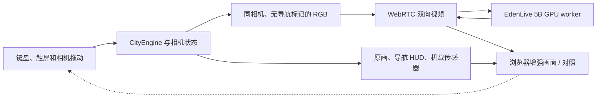

# CityNav × EdenLive 5B 实时写实渲染 Code Plan

## 1. 交付目标

在现有 CityNav 模拟城市中加入可切换的 **原画 / 增强 / 对照** 视图。浏览器按当前相机和仿真状态采集画面，GPU 服务运行 EdenLive 5B，将写实结果串流回同一页面。用户能在追踪、机器人视角下驾驶、拖动、缩放和复位。俯视保留原画，作为查看城市全局和排查问题的视图。

首版以**人的交互回显**为交付目标。CityEngine 继续负责 20 Hz 仿真步进、车辆、行人、天气、信号灯、碰撞和结算。现有 `CityNav.policy` 继续提供机载观测。写实 RGB 用于导航策略时须另过传感器对齐和闭环门槛。[仿真引擎](../src/engine.mjs) · [浏览器入口](../src/app.mjs)

## 2. 架构与模块

| 模块与拟定文件 | 职责 |
| --- | --- |
| `src/renderer.mjs`、`src/eden-capture.mjs` | 从现有 `CityRenderer.render()` 提取求解显示相机和输出至指定画布的公共逻辑。普通渲染与采集复用同一组位姿、FOV、场景状态及天气。首次开启增强时创建专用采集画布，使用 `showRoute:false` 排除路线标记与终点圈。保留现有机载传感器的 `grabFrame()` 路径。 |
| `src/eden-session.mjs` | 管理 WebRTC 和会话生命周期。封装启动、停止、重连、视频轨切换及有效帧判断。向 UI 发出 `connecting`、`warming`、`live`、`fallback`。渲染代码无需知道服务端实现。 |
| `src/eden-view.mjs`、`src/app.mjs` | 显示原画、增强和对照。保留现有指针交互层与 HUD。显示帧率、画面延迟及退回原画状态。任务暂停、重置和切视角通过应用现有入口触发。 |
| `services/eden/rtc/`、`services/eden/session.py` | 负责媒体接入、会话绑定、超时清理、队列与帧元数据。优先接入自托管的 EdenLive Reactor 模块，使用客户端输入轨 `source_video`，接收 `draft_video` 和 `main_video`。若公开版本缺少逐帧映射钩子，在适配层补齐。 |
| `services/eden/worker.py`、`services/eden/profiles/` | 启动并预热 5B 四步流式模型。将首帧、提示词、输入批次和会话缓存交给上游推理。记录推理、解码和显存。设备、模型版本、精度和分辨率集中配置。 |
| `tools/eden/` | 硬件探测、固定轨迹导出、GPU 微基准、浏览器闭环、画面对齐和验收报告。复用现有基准任务与参考路线。 |

优先复用上游的客户端视频输入和推理代码。将运行时修改限制在 Ada 配置、会话与帧映射适配层。离线 HTML 继续走现有构建流程。增强模式只在配置了服务地址时启用，由浏览器在本地开发地址或受信任的 HTTPS 页面运行。服务地址和密钥走部署配置。先验证局域网直连，再按实际网络需要接入 TURN。[现有渲染器](../src/renderer.mjs) · [EdenLive 自托管与客户端输入](https://github.com/VAST-AI-Research/EdenLive/blob/main/reactor/README.md#controls-and-playback) · [EdenLive 视频轨接口](https://www.reactor.inc/models/eden-live/api)

## 3. 画面、帧与控制协议

1. **采集同一时刻的画面。** 在浏览器每次采集前固定当前渲染状态。记录 `sessionId`、`epoch`、`frameId`、`simTick`、`capturedAt`、相机位姿和 FOV。驾驶画面以 1280×704、24 fps 为目标。分辨率与帧率走配置，保持投影宽高比一致。以原始采样时间播放，仿真仍按自身步长运行。采集优先用浏览器视频轨，避免逐帧 JPEG 编码或 GPU 同步读回进入主循环。
2. **保留真实状态。** 采集画面包含正在运动的人车、实际灯色及现有天气效果。提示词只描述写实材质、曝光和同一天气。首帧参考与开局相机和场景构图对齐，随验收片段固化。其他场景先用当前原画作为首帧并报告效果差异。部署从本地加载已有参考图，按权重组件检查许可证。[EdenLive 模型卡与组件许可](https://huggingface.co/VAST-AI/EdenLive#license)
3. **配对每帧。** 服务端记录输入视频时间戳、输出视频时间戳与源帧映射，经旁路返回 `epoch`、输入范围、输出序号和丢帧原因。区分对应到实际源帧的输出与模型生成的中间帧。浏览器用 `requestVideoFrameCallback` 和实际媒体时间戳计算呈现时间。开发时若媒体时间戳无法映射，使用测试专用帧标识在采集和输出边界打点，在进模型前去掉标识。无法配对的画面标为未验证并计入覆盖率。[浏览器视频帧回调规范](https://wicg.github.io/video-rvfc/)
4. **优先保持操作流畅。** 每会话最多一个正在生成的片段和一个有界的待处理输入窗口。超出视图时延预算时回到原画，记录丢帧，按上游允许的方式重新同步，避免任意跳帧后把旧缓存用于新场景。相机连续拖动使用同一段历史，切场景、重试和相机模式瞬切增加 `epoch`。只显示当前 `epoch` 的结果，新会话加载期间用原画。对照中的配对帧使用同一 tick，操控时的实时 HUD 使用当前 tick，迟到片段不叠加会被误读为同帧的灯色提示。

## 4. 四张 48 GB 4090 的部署计划

- **上机核验。** 按用户提供的 **4 × RTX 4090、每卡 48 GB** 编排。NVIDIA 公版规格是每卡 24 GB、Ada SM 8.9、无 NVLink。启动前用 `nvidia-smi -L`、`nvidia-smi --query-gpu=index,uuid,name,memory.total,driver_version --format=csv`、`nvidia-smi topo -m` 和 PyTorch 设备探测确认实际可用设备、显存、PCIe 拓扑、BF16 与所选内核。逐卡执行模型加载与持续生成测试。[NVIDIA 4090 官方规格](https://www.nvidia.com/en-us/geforce/graphics-cards/40-series/rtx-4090/#specs)
- **GPU 0 先跑通参考实现。** 固定上游代码 commit、权重 revision、依赖和容器。先在一张卡跑上游随附样例，使用 5B 四步流式、BF16 和兼容 Ada 的注意力后端。以可运行的一次完整录制作为基线，再接 WebRTC。记录加载时长、预热、首片段、稳态推理和峰值显存。[上游 5B 配置](https://huggingface.co/VAST-AI/EdenLive#usage) · [参考实现与兼容后端开关](https://github.com/VAST-AI-Research/EdenLive/blob/main/reactor/README.md#2-start-the-model)
- **GPU 1 做同输入对照。** 逐项试 LightTAE、合适的注意力内核、`torch.compile` 与 CUDA Graph，确认 Ada 兼容后才试量化。每次对同一输入比较画质、推理和到屏延迟。5090 的公开结果是特定配置的复现参考，其 FP8 profile 针对 SM120。4090 的保守档从低输入负载、较小的上游支持分辨率或回放模式中实测选择。[LightX2V EdenLive 基准](https://github.com/ModelTC/LightX2V/blob/main/scripts/edenlive/README.md#rtx-5090-results) · [量化后端说明](https://github.com/ModelTC/LightX2V/blob/main/docs/EN/source/method_tutorials/quantization.md)
- **GPU 2、3 跑并发与故障。** 通过单卡验收后，在四张卡各启动一个预热 worker，按 UUID 固定设备。每个会话独占一个 worker 到释放，首版覆盖最多 4 路并发。记录并发相对单路的退化。断连释放会话，有空闲卡时重建会话，满载时浏览器继续使用原画。
- **单路瓶颈处理。** 四卡并发主要增加吞吐。若单路因显存或处理阶段受阻，先用逐段计时定位，再评估将编码或解码分卡。只有在计入 PCIe 传输后，端到端 p95 比单卡更低且通过同一画质门槛时才采用。默认每卡独立管理显存与模型缓存。

## 5. 分阶段实施与闭环验证

| 阶段 | 实施 | 通过证据 |
| --- | --- | --- |
| A. 参考基线 | 上机探测。用上游样例和固定提示词跑通单卡离线及流式参考。固定部署配置和版本。 | 有可重放的视频、帧数、首帧时间、稳态 FPS、显存峰值以及环境清单。相同配置可再次启动。 |
| B. 传输闭环 | 先用直通后端连接网页采集、WebRTC 和浏览器显示，附带帧映射。浏览器自动测试驾驶、拖动、缩放、暂停、复位、切场景和断网。 | 输入动作确实改变仿真与源画面。回显帧能追溯到同一 tick，旧会话帧不会覆盖新视角，超时会退回原画。 |
| C. 真实模型闭环 | 将直通换为真实 5B worker，按固定种子及动作序列做原画／增强对照，再通过真实 UI 输入验证。将捕获、编码、RTT、推理、解码、呈现分别计时。 | 录制回显对照与事件日志。逐例报告画质、语义一致性、帧映射覆盖、浏览器延迟和掉帧。直通结果只计作链路验证。 |
| D. 真实 GPU 并发与恢复 | 逐卡运行同一用例，测试 1 路和 4 路。并发时每路用不同场景或种子。主动停止测试 worker、断开客户端再重连。 | 多会话无串流，失败会回退，恢复后使用新会话。回收会话缓存与视频轨。报告单卡及每会话的吞吐、显存、温度、超时和恢复时间。 |
| E. 原有回归与交付 | 运行现有 2,160 条标准任务和 48 条极限任务校验。用 Go2、B2、G1 各跑一遍。对同种子和动作序列比较增强开／关时的位姿、规则事件、分数、终态和原始传感器采样。用 `python3 build.py` 重建，测试离线入口与伦敦实景能独立启动。 | 逐步仿真状态和原始观测一致，有离线回归结果及部署文档。 |
| F. 机载观测闭环试验 | 在独立测试入口，用一个消费机载 RGB 的测试策略执行至少一次“看画面后减速或转向”的闭环。原画与增强分别驱动后续仿真，并保留每次观测和动作之间的映射。接入用户策略后再做正式任务评测。 | 策略确实读到本次采样对应的图像，动作改变下一时刻状态。可重放原画、增强和超时用例，留存各自的动作与结果。 |

### 固定验收场景

| Episode | 核验画面和交互 |
| --- | --- |
| `boulevard-01-e02` | 白天基线。驶近信控横道、停车等待信号切换、转向，做快速横拖、滚轮和视角复位。 |
| `market-09-x04` | 双向人潮。起步、制动、等待一组人从近前横穿并完全离开，核对人流、遮挡和位置。 |
| `office-09-x05` | 拥堵排队。核对队首停车、排队车辆数和启动顺序。 |
| `transit-09-x06` | 雨夜晚高峰。核对湿路、近处车辆、红绿灯及横穿行人，同场景重试后继续测试。 |
| `school-02-x02`、`boulevard-08-x03` | 暴雪与浓雾。记录远处能见度、近处障碍和路缘的表现。 |

每个场景提供可重复的 60 秒左右脚本，含关键事件前后的片段。场景切换、重试、拖动和断网用实际浏览器事件触发。固定回放使用相同 seed、逐 tick 动作和相机操作；显存、耗时和失败帧也入报告。性能压力使用持续 30 分钟的真实会话轮换。[任务清单](../benchmark/episodes.json) · [现有可达性校验器](../tools/verify-benchmark.mjs)

### 拟定验收门槛

- **帧和时延。** 用同一个浏览器的单调时钟，测输入或相机变更到首个体现该变化的增强帧提交合成的时间，同时测采集到呈现的帧龄。分别报告 p50、p95、播放停顿、可配对帧占比、输出吞吐、实际新帧 FPS 和回退占比。按卡、分辨率和网络环境给出冷启动与预热后的数据。用至少 30 次可配对的输入探针估计每种负载的 p95。首版交互档建议门槛为预热后首画面 p95 ≤ 8 s、持续新帧 ≥ 20 FPS、端到端 p95 ≤ 800 ms、可配对帧 ≥ 95%、正常测试时段增强可用 ≥ 95%。重复帧和回退原画分别计数。每个用例单独过门槛。并发容量按同时达标的路数发布。达不到交互档时，报告实际可用的回放或预览档，并保留原画作为驾驶界面。上述数字是试验目标。
- **语义与写实。** 用同帧的原画、可见对象与信号真值进行对照。验收片段覆盖近处可见的行人、车辆、骑行者和红绿灯。人工逐段核对，自动汇总新增、漏检、错色、漂移、遮挡关系和雨雾条件。预先标注哪些对象可判读，并公布采样数量和不确定项。抽检中停止信号变为通行、近处关键人车凭空消失或新增均需复查并修正，未解决的用例保留为失败。并排对比静帧和连续镜头，覆盖镜头返回原处时的外观变化。画质报告同时保留代表性改善和失败片段。
- **故障与原画。** 断网、GPU 拒绝、服务异常和超时均验证，原画能继续操控和结算。退回时间从检测到异常起计，目标 ≤ 1 s。故障解除后，有可用 worker 时须拉起新会话，验证身份正确且预热后的重新出画耗时入报告。
- **策略闭环单独验收。** 独立实验按 `观察当前机载 RGB → 等待同一采样的增强图 → 推理动作 → 推进 CityEngine → 请求下一帧` 运行。实验相机使用机载传感器位姿。其他传感器沿用现有采样率、延迟和各自时间戳，以当前决策时刻已送达的原始观测为准。只有与机载 RGB 同一采样且来源可核验的增强帧可作为本轮输入。用相同模型、相同种子和同一组任务跑原始 RGB 与增强 RGB 两组，分别报告成功率、安全分、碰撞、闯灯、超时和推理耗时。丢帧、超时及采用的回退策略需留痕，回退样本单列。现有真值参考控制器用于验证可达性。有真实机器人观测对照时再判断 sim-to-real 收益。

## 6. 交付清单

- [ ] CityNav 的增强视图、独立采集与可替换的媒体客户端模块。
- [ ] 单卡与四卡可复现的部署配置，含模型与依赖版本、参考图及来源、预热和自检命令。
- [ ] 自动化浏览器回显测试、固定输入和场景描述、逐项可重跑的验收脚本。
- [ ] 结构化指标报告、并排示例视频、明确标注通过档位与未通过用例。报告涵盖实际 GPU 型号和显存、精度、分辨率、并发、网络路径及端到端时延。
- [ ] 运行说明覆盖本地离线原画、GPU 服务启停、浏览器连接、故障恢复和策略实验入口。

当前为实施计划。四卡实际可用显存、Ada 加速内核和 CityNav 实时档位以上机数据为准。
